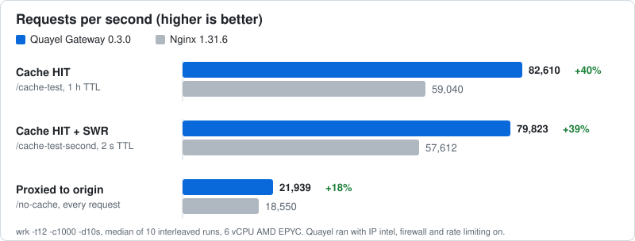

<div align="center">

# Quayel Gateway

**The API gateway that knows who's calling, and serves cached traffic 40% faster than Nginx.**

Firewall, rate limiting, caching, transforms, load balancing and automatic HTTPS in one Rust binary,<br>
with country, ASN, VPN, Tor and datacenter data for every visitor built in. Nothing else to run.

[](https://github.com/quayel/Quayel-Gateway/releases)
[](https://hub.docker.com/r/quayel/quayel-gateway)
[](LICENSE)
[](https://github.com/cloudflare/pingora)
[](#install)

[**Quick start**](#try-it-in-30-seconds) · [**Benchmarks**](#benchmarks) · [**Features**](#what-you-get) · [**Install**](#install) · [**Docs**](https://docs.quayel.com/quayel-gateway/getting-started/installation)

</div>

<table>
<tr>
<td align="center" width="25%">
<h3>+40%</h3>
requests per second on cache hits vs Nginx
</td>
<td align="center" width="25%">
<h3>+18%</h3>
requests per second proxying to the origin vs Nginx
</td>
<td align="center" width="25%">
<h3>1 binary</h3>
no Redis, etcd, database or sidecars
</td>
<td align="center" width="25%">
<h3>~5 μs</h3>
to tag a visitor with country, ASN, VPN, Tor and risk score
</td>
</tr>
</table>

## Try it in 30 seconds

```bash
# 1. Something to put the gateway in front of
python3 -m http.server 3000 &

# 2. A starter config: IP intel, a Tor block, a 60 s cache and a response header
curl -sLo config.json https://raw.githubusercontent.com/quayel/Quayel-Gateway/main/examples/config.quickstart.json

# 3. Run the gateway (Linux; host networking lets it reach port 3000)
docker run --rm -d --name quayel --network host \
  -v $PWD/config.json:/etc/quayel-gateway/config.json:ro quayel/quayel-gateway

# 4. Ask twice
curl -s -o /dev/null -D - http://localhost:8080/ | grep -i cache-status   # MISS
curl -s -o /dev/null -D - http://localhost:8080/ | grep -i cache-status   # HIT
```

The second request never reaches the backend, and both carry `X-Powered-By: Quayel Gateway` from a response transform. Edit `config.json` while it runs and the change applies within 5 seconds. Stop it with `docker stop quayel`. No Docker? Run the [binary](#linux-binary) with `./quayel-gateway config.json`. For a real setup, see [Install](#install) and [Your first config](#your-first-config).

## Benchmarks

Same machine, same origin, same cache rules, same load. Quayel Gateway served **40% more requests per second than Nginx on cache hits** and **18% more when proxying to the origin**, with lower latency on every route. It did that with IP intelligence, the firewall and rate limiting **switched on**, work Nginx wasn't doing.

<p align="center">
  
</p>

| Route | Nginx 1.31.6 | **Quayel 0.3.0** | Faster by | p50 latency | p99 latency |
|---|---:|---:|---:|---|---|
| Cache HIT (1 h TTL) | 59,040 rps | **82,610 rps** | **+40%** | 15.2 → **10.7 ms** | 50.2 → **43.9 ms** |
| Cache HIT (2 s TTL, stale-while-revalidate) | 57,612 rps | **79,823 rps** | **+39%** | 15.3 → **11.1 ms** | 55.0 → **44.1 ms** |
| Proxied to the origin every time | 18,550 rps | **21,939 rps** | **+18%** | 50.2 → **42.1 ms** | 108.2 → **91.9 ms** |

Median of 10 interleaved runs per route. Quayel won 28 of the 30 head-to-head runs, and neither server returned a single error. The new request and response transforms add no measurable cost, even on every cache hit.

<details>
<summary><b>How it was measured, and how to reproduce it</b></summary>

- **Load:** `wrk -t12 -c1000 -d10s --latency` (12 threads, 1,000 connections, 10 seconds) per run, after a 2-second warm-up per route.
- **Interleaved:** every rep runs both servers back to back and alternates which goes first, so drift on the box affects both equally.
- **Machine:** 6 vCPU AMD EPYC, 11 GB RAM. `wrk`, both servers and nothing else on the same box. Both started with `ulimit -n 100000`.
- **Nginx 1.31.6** (`nginx:alpine`, host networking), config in [`scripts/bench/nginx-mirror/nginx.conf`](scripts/bench/nginx-mirror/nginx.conf): `worker_processes auto`, upstream keepalive, `proxy_cache` with `proxy_cache_lock`, `use_stale updating` and background update, access log off.
- **Quayel Gateway** release build with `ip_intel`, `firewall` and `rate_limiting` on, cache keyed on the path, round-robin to the same origin, access log off.
- **Caveats:** results on this box vary by ±10–15% between single runs, which is why it takes 10 interleaved reps. Nginx's cache is file-backed (served from the page cache); Quayel's is in memory.

Reproduce: start both, then `bash scripts/bench/bench_vs_nginx.sh 10`. Raw results: [`scripts/bench/results/gateway-vs-nginx-20261011.csv`](scripts/bench/results/gateway-vs-nginx-20261011.csv). Full write-up: [Benchmarks](https://docs.quayel.com/quayel-gateway/operations/benchmarks).
</details>

## What you get

Every request goes through one fixed pipeline. Any step can answer early: the firewall returns `403` before a backend is ever contacted, and a cache hit never touches the load balancer.

```
client ─▶ IP Intel ─▶ Firewall ─▶ Rate Limit ─▶ Request Transform ─▶ Cache ─▶ Load Balancer ─▶ backend
                                                                       │
                                               HIT / STALE ◀───────────┘
                                                    │
client ◀──────────────── Response Transform ◀───────┴──────────────────────── origin response
                                                    │
                                            JSONL access log
```

<table>
<tr>
<td width="50%" valign="top">

### 🌍 Knows every visitor
Country, region and city, ASN and organisation, hosting provider (`Hetzner Online GmbH`, `Amazon.com, Inc.`), VPN, Tor, proxy, datacenter and Cloudflare-edge flags, and a risk score. About 140 MB of IP data is compiled into the binary, so there are no downloads or lookups at runtime. [IP Intelligence →](docs/plugins/ip-intel.md)

</td>
<td width="50%" valign="top">

### 🛡️ Firewall on anything
Allow, block or redirect on method, path, host, headers, cookies or any IP field: `ip.is_tor`, `ip.risk_score > 30`, `ip.country != "DE"`. Every plugin uses the same rule conditions. [Firewall →](docs/plugins/firewall.md)

</td>
</tr>
<tr>
<td width="50%" valign="top">

### ⏱️ Rate limiting and DoS protection
Sliding-window limits keyed by IP, header, cookie or expression. Slowloris, slow-POST, connection-flood and request-flood protection is on by default, with automatic temporary bans. [Rate Limiting →](docs/plugins/rate-limiting.md)

</td>
<td width="50%" valign="top">

### ⚡ In-memory cache
Custom TTLs, cache keys and bypass rules. Stale-while-revalidate with a single-request lock, conditional revalidation (`304`), and stale-if-error when the origin fails. [Cache →](docs/plugins/cache.md)

</td>
</tr>
<tr>
<td width="50%" valign="top">

### 🔀 Request and response transforms
Rewrite the path, query and headers before the cache and origin. Set headers and status codes on every response, including cache hits. The cache stores the raw origin response, so one visitor's output never leaks to another. [Transform →](docs/plugins/transform.md)

</td>
<td width="50%" valign="top">

### ⚖️ Load balancing
Round-robin, weighted, least-connections, sticky sessions and fast-response, with active health checks. Cached responses are still served when every backend is down. [Load Balancer →](docs/plugins/load-balancer.md)

</td>
</tr>
<tr>
<td width="50%" valign="top">

### 🔒 HTTPS without certbot
Let's Encrypt certificates are issued on the first request for a domain and renewed automatically. [Auto-SSL →](docs/plugins/auto-ssl.md)

</td>
<td width="50%" valign="top">

### 📜 Logs you can query
One JSON line per request with the visitor's IP data and which rule blocked it, sent to a file, ClickHouse, Datadog, OpenTelemetry, Loki, Elasticsearch or Splunk, plus a Prometheus `/metrics` endpoint. Config changes are hot-reloaded within 5 seconds, and a broken file is rejected while the old config keeps running. [Logging →](docs/logging.md)

</td>
</tr>
</table>

## How it compares

| | **Nginx** | **Apache HTTP Server** | **Apache APISIX** | **Quayel Gateway** |
|---|---|---|---|---|
| Core | C, event-driven | C, process/thread MPM | Nginx + Lua (OpenResty) | **Rust on Pingora** |
| Config | `nginx.conf` + reload | `httpd.conf` / `.htaccess` | etcd + YAML / Admin API | **one JSON file, hot reload** |
| Extra services needed | — | — | etcd | **none** |
| IP intelligence (Geo / ASN / VPN / Tor / proxy) | 3rd-party modules | 3rd-party modules | plugins (partial) | **built in, data in the binary** |
| Rate limiting | `limit_req` (fixed window) | `mod_ratelimit` / ModSecurity | limit-req / limit-count | **sliding window, built in** |
| Caching | `proxy_cache` | `mod_cache` | proxy-cache plugin | **built in, in memory** |
| Request / response transforms | `rewrite`, `add_header`, `more_set_headers` | `mod_rewrite`, `mod_headers` | proxy-rewrite, response-rewrite | **built in, applied on cache hits** |
| Load balancing | RR, hash, least_conn | `mod_proxy_balancer` | RR, chash, ewma | **RR, weighted, least-conn, sticky, fast-response** |
| HTTPS automation | certbot | certbot | plugin / external | **built in (ACME)** |
| Access logs | text | text | JSON via plugins | **JSONL with IP data and timing** |
| Deployment | binary + modules | binary + modules | OpenResty + etcd + dashboard | **one binary** |
| Maturity | very large ecosystem | very large ecosystem | large and growing | **young, batteries included** |

<details>
<summary><b>The same job in all four: proxy <code>api.example.com</code> to <code>127.0.0.1:3000</code></b></summary>

**Nginx**

```nginx
upstream backend { server 127.0.0.1:3000; }

server {
    listen 80;
    server_name api.example.com;

    location / {
        proxy_pass http://backend;
        proxy_set_header Host $host;
        proxy_set_header X-Real-IP $remote_addr;
        proxy_set_header X-Forwarded-For $proxy_add_x_forwarded_for;
    }
}
```

**Apache HTTP Server**

```apache
<VirtualHost *:80>
    ServerName api.example.com

    ProxyPreserveHost On
    ProxyPass        / http://127.0.0.1:3000/
    ProxyPassReverse / http://127.0.0.1:3000/
</VirtualHost>
```

**Apache APISIX**

```bash
# etcd must be running first
curl -X PUT http://127.0.0.1:9180/apisix/admin/routes/1 \
  -H 'X-API-KEY: edd1c9f034335f136f87ad84b625c8f1' -d '
{
  "uri": "/*",
  "hosts": ["api.example.com"],
  "upstream": {
    "type": "round_robin",
    "nodes": { "127.0.0.1:3000": 1 }
  }
}'
```

**Quayel Gateway:** see [Your first config](#your-first-config).
</details>

## Install

| Method | Best for | Platforms |
|---|---|---|
| [Docker](#docker) | Trying it out, containers, any Linux distro | amd64, arm64 |
| [`.deb` package](#deb-package-ubuntu--debian) | Servers, with a systemd service and log rotation set up | Ubuntu 22.04+, Debian 12+ |
| [Linux binary](#linux-binary) | Anything else with glibc 2.35+ | x86_64, aarch64 |
| [From source](#from-source) | Development, custom builds | Linux |

### Docker

```bash
docker run --rm -p 8080:8080 -p 8443:8443 \
  -v $PWD/config.json:/etc/quayel-gateway/config.json:ro \
  quayel/quayel-gateway
```

Also on GitHub's registry as `ghcr.io/quayel/quayel-gateway`. Tags: `:latest`, `:0.4.0`, `:0.4`. For a production-style setup with HTTPS on ports 80/443 and saved certificates, use `docker compose up -d` with the included [`docker-compose.yml`](docker-compose.yml).

<details>
<summary><b>Auto-SSL in Docker</b></summary>

- **Keep your certificates.** Certificates and the ACME account key live in `/var/lib/quayel/certs`. Mount a volume there (`-v quayel-certs:/var/lib/quayel/certs`, or use the compose file). Without it, every restart requests new certificates and you will hit Let's Encrypt rate limits.
- **Open port 80.** Let's Encrypt checks your domain over port 80 from the internet. Map `80:8080` and `443:8443` when using the demo listeners, or listen on 80/443 directly.
- **Shutdown is clean.** On `SIGTERM` the gateway finishes in-flight requests (5 s grace + 5 s drain), inside Docker's 10 s stop timeout.

To build the image yourself, run `docker build -t quayel-gateway .`. The build downloads the IP data if `src/data/` is empty, so rebuilding is also how you refresh it.
</details>

### `.deb` package (Ubuntu / Debian)

```bash
VERSION=0.4.0
ARCH=$(dpkg --print-architecture)  # amd64 or arm64
curl -LO https://github.com/quayel/Quayel-Gateway/releases/download/v$VERSION/quayel-gateway_${VERSION}_$ARCH.deb
sudo apt install ./quayel-gateway_${VERSION}_$ARCH.deb

sudo nano /etc/quayel-gateway/config.json   # point it at your backend
sudo systemctl start quayel-gateway
```

<details>
<summary><b>What the package installs</b></summary>

| What | Where |
|------|-------|
| The gateway | `/usr/bin/quayel-gateway` |
| Your config | `/etc/quayel-gateway/config.json`: listens on port 80 and forwards to `127.0.0.1:3000`. Upgrades never overwrite your edits |
| systemd service | `quayel-gateway.service`, runs as the `quayel` user and may bind ports 80/443. Enabled but not started |
| Access log | `/var/log/quayel/access.jsonl`, rotated daily (14 days kept) |
| Certificates | `/var/lib/quayel/certs` |
| Example configs | `/usr/share/doc/quayel-gateway/examples/` |

Follow the logs with `journalctl -u quayel-gateway -f`. To upgrade, install the newer `.deb` the same way. `sudo apt remove quayel-gateway` keeps your config and certificates; `sudo apt purge quayel-gateway` deletes them too.
</details>

### Linux binary

```bash
VERSION=v0.4.0
ARCH=x86_64                        # or aarch64
curl -LO https://github.com/quayel/Quayel-Gateway/releases/download/$VERSION/quayel-gateway-$VERSION-$ARCH-unknown-linux-gnu.tar.gz
tar xzf quayel-gateway-$VERSION-$ARCH-unknown-linux-gnu.tar.gz
cd quayel-gateway-$VERSION-$ARCH-unknown-linux-gnu
./quayel-gateway config.json       # the demo config; edit it first
```

Needs glibc 2.35 or newer (Ubuntu 22.04+, Debian 12+). On older systems, including RHEL/Rocky/Alma 9 and Amazon Linux 2023, use the Docker image. Check the download with `sha256sum -c --ignore-missing SHA256SUMS` from the release page.

### From source

```bash
git clone https://github.com/quayel/Quayel-Gateway.git
cd Quayel-Gateway
./setup.sh                    # downloads the IP data and installs Rust + build tools
cargo build --release         # the data is compiled into the binary
./target/release/quayel-gateway examples/config.demo.json
```

## Your first config

This sends all traffic for `api.example.com` to a backend on `127.0.0.1:3000`, with IP intelligence turned on:

```json
{
  "gateway_id": "gw-01",
  "gateway_name": "default",
  "server_name": "api.example.com",
  "config_version": "1",
  "listen": { "http": "0.0.0.0:8080" },
  "client_ip": { "source": "peer_ip" },
  "plugins": {
    "ip_intel": { "enabled": true },
    "load_balancer": {
      "enabled": true,
      "load_balancers": [{
        "id": "default",
        "name": "Backend",
        "enabled": true,
        "conditions": [],
        "algorithm": { "type": "round_robin" },
        "targets": [
          { "id": "t1", "host": "127.0.0.1", "port": 3000, "protocol": "http", "weight": 100, "enabled": true }
        ],
        "host_header": { "mode": "visitor" },
        "health_check": { "mode": "off" }
      }]
    }
  }
}
```

| Field | Meaning |
|-------|---------|
| `gateway_id`, `gateway_name`, `config_version` | Labels for this gateway and config. Only `gateway_id` is written to the access log. Bump `config_version` when you edit the file so you can tell versions apart |
| `listen` | Where the gateway accepts traffic. Optional: without it, HTTP uses port 80 and HTTPS (with Auto-SSL) uses 443 |
| `client_ip` | How to find the real visitor IP. `peer_ip` is right when clients connect directly. Behind Cloudflare or a cloud load balancer, read `X-Forwarded-For` with `{ "source": "header_index", "header": "X-Forwarded-For", "index": 0, "fallback": "peer_ip" }`. Never do that when the gateway faces the internet directly, because clients can fake the header |
| `plugins.load_balancer` | Where requests go. `conditions: []` means "match every request" |

Start it with `quayel-gateway config.json`. [`examples/config.demo.json`](examples/config.demo.json) turns on every plugin, and the [Configuration Reference](docs/configuration.md) lists every field. [`docs/config.schema.json`](docs/config.schema.json) validates a config in any editor.

## Common recipes

Every firewall, rate-limit, transform, cache and load-balancer rule uses the same **conditions**, and all conditions in a rule must match:

```json
{ "left": "<field>", "operator": "<operator>", "value": <value> }
```

Fields include `req.path`, `req.method`, `req.host`, `req.headers.<name>`, `req.client_ip` and every `ip.*` field. Operators include `equals`, `starts_with`, `regex` and `greater_than`. See [Conditions](docs/conditions.md) for the full list.

<details>
<summary><b>Block Tor exit nodes and high-risk IPs</b></summary>

```json
"firewall": {
  "enabled": true,
  "rules": [
    {
      "id": "block-tor", "name": "Block Tor exit nodes", "enabled": true,
      "conditions": [{ "left": "ip.is_tor", "operator": "equals", "value": true }],
      "action": { "type": "block", "status": 403 }
    },
    {
      "id": "block-high-risk", "name": "Block risk score above 30", "enabled": true,
      "conditions": [{ "left": "ip.risk_score", "operator": "greater_than", "value": 30 }],
      "action": { "type": "block", "status": 403 }
    }
  ]
}
```
</details>

<details>
<summary><b>Rate-limit a login endpoint (10 requests per minute per IP)</b></summary>

```json
"rate_limiting": {
  "enabled": true,
  "rules": [{
    "id": "login-rate", "name": "Login rate limit", "enabled": true,
    "conditions": [
      { "left": "req.path",   "operator": "equals", "value": "/api/auth/login" },
      { "left": "req.method", "operator": "equals", "value": "POST" }
    ],
    "key": "req.client_ip",
    "limit": 10,
    "window_seconds": 60,
    "action": { "type": "block", "status": 429 }
  }]
}
```
</details>

<details>
<summary><b>Cache static files for a day</b></summary>

```json
"cache": {
  "enabled": true,
  "max_object_size_bytes": 10485760,
  "rules": [{
    "id": "cache-static", "name": "Cache static assets", "enabled": true,
    "conditions": [{ "left": "req.path", "operator": "regex", "value": "\\.(css|js|woff2?|png|jpg|jpeg|gif|webp|svg|ico)$" }],
    "cache": "eligible",
    "edge_ttl":    { "mode": "custom", "seconds": 86400 },
    "browser_ttl": { "mode": "custom", "seconds": 3600 },
    "cache_key":   { "mode": "default" },
    "statuses": [200, 301]
  }]
}
```
Check the `Quayel-Cache-Status` response header: `MISS` on the first request, then `HIT`.
</details>

<details>
<summary><b>Rewrite <code>/api/*</code> to <code>/v1/*</code> and add headers to every response</b></summary>

```json
"request_transform": {
  "enabled": true,
  "rules": [{
    "id": "api-v1",
    "conditions": [{ "left": "req.path", "operator": "starts_with", "value": "/api/" }],
    "actions": [
      { "type": "path",   "operation": "replace_prefix", "from": "/api", "to": "/v1" },
      { "type": "header", "operation": "set", "name": "X-Service", "value": "quayel" }
    ]
  }]
},
"response_transform": {
  "enabled": true,
  "rules": [{
    "id": "powered-by",
    "actions": [
      { "type": "header", "operation": "set",    "name": "X-Powered-By", "value": "Quayel" },
      { "type": "header", "operation": "remove", "name": "Server" }
    ]
  }]
}
```
The firewall and rate limiter still see the original `/api/...` path, so a rewrite can't get around them. The cache key uses the rewritten path.
</details>

<details>
<summary><b>Redirect <code>www</code> to the bare domain</b></summary>

```json
{
  "id": "redirect-www", "name": "Redirect www", "enabled": true,
  "conditions": [{ "left": "req.host", "operator": "equals", "value": "www.example.com" }],
  "action": { "type": "redirect", "status": 301, "location": "https://example.com" }
}
```
Add this to `plugins.firewall.rules`.
</details>

<details>
<summary><b>Send <code>/api/</code> to a separate pool with health checks</b></summary>

Load balancers are checked in order, and the first one whose conditions match handles the request. Put specific pools first and a catch-all (`"conditions": []`) last.

```json
{
  "id": "api-backend", "name": "API pool", "enabled": true,
  "conditions": [{ "left": "req.path", "operator": "starts_with", "value": "/api/" }],
  "algorithm": { "type": "round_robin" },
  "targets": [
    { "id": "api-1", "host": "10.0.1.10", "port": 8080, "protocol": "http", "weight": 100, "enabled": true },
    { "id": "api-2", "host": "10.0.1.11", "port": 8080, "protocol": "http", "weight": 100, "enabled": true }
  ],
  "host_header": { "mode": "visitor" },
  "health_check": {
    "mode": "https", "path": "/health", "interval_seconds": 5, "timeout_ms": 2000,
    "expected_statuses": [200], "healthy_threshold": 2, "unhealthy_threshold": 3
  }
}
```
Health-check modes are `https` (request `path` and check the status, using each target's own `protocol`), `accepts_connections` (TCP connect only) and `off`.
</details>

## Running it

```
quayel-gateway [--workers N] [CONFIG_PATH]
```

| Option / variable | Default | Meaning |
|---|---|---|
| `CONFIG_PATH` | `$QUAYEL_GATEWAY_CONFIG`, then `/etc/quayel-gateway/config.json`, then `./config.json` | Config file. The startup line `Config file: ...` shows which one was picked |
| `--workers N` | `server.workers`, else all CPU cores | Worker threads |
| `--version`, `-V` | | Print the version and exit |
| `RUST_LOG` | `info` | Level of the gateway's own output (`debug`, `info`, `warn`, `error`) |
| `QUAYEL_IP_INTEL_CACHE_SIZE` | `65536` | IP lookups kept in memory |

- **Hot reload:** the config file is checked every 5 seconds. A valid file is applied with no restart and no dropped connections (`Config hot-reloaded successfully`). An invalid one is rejected and the last good config keeps running (`Config validation FAILED`, with the reason).
- **Logs:** the gateway's own output goes to stdout as JSON. Access logs are one JSON line per request, written to the file set in `plugins.logging` (`tail -f /var/log/quayel/access.jsonl | jq .`) and, with `sinks`, to stdout, ClickHouse, Datadog, OpenTelemetry, Loki, Elasticsearch, Splunk or any HTTP endpoint. A Prometheus endpoint is available with the top-level `metrics` section. Outside the `.deb`, set up `logrotate` for that file. Fields: [Logging](docs/logging.md).

<details>
<summary><b>Troubleshooting</b></summary>

| Problem | What to check |
|---------|---------------|
| Gateway exits right after starting | Look for `Failed to load config` or `Failed to compile config` in the output. The message names the bad field |
| Config edits don't take effect | Look for `Config validation FAILED`. The gateway keeps the last good config until the file is fixed |
| Every visitor has the same IP, or IP data looks wrong | `client_ip` doesn't match your setup. Use `peer_ip` when clients connect directly, and `header_index` / `header` only behind a trusted proxy |
| Requests fail or hang with no backend response | Check the target `host` and `port`, and make sure no target points back at the gateway's own `listen` address |
| `503` with a "no healthy upstream" body | Every target in the pool failed its health check. Check that `health_check.path` returns one of `expected_statuses` |
| HTTPS certificate isn't issued | Port 80 must be reachable from the internet, the domain must be in `auto_ssl.domains` and its DNS must point at this server |
| Let's Encrypt rate-limit errors in Docker | Certificates aren't being kept. Mount a volume at `/var/lib/quayel/certs` |
| Clients get `429` with an `X-Quayel-Block-Reason` header | The built-in flood protection refused them. If it's real traffic, raise `server.protection.max_requests_per_ip_per_sec` or add the IPs to `exempt_ips`. Behind a proxy, set `client_ip` so the limit applies per visitor |
| Large uploads fail with `413` | Raise `server.limits.max_body_bytes` (default 100 MB) |
| `localhost` / `127.0.0.1` has no country | Expected. Private and local IPs aren't in the GeoIP databases |

For more detail, run with `RUST_LOG=debug`.
</details>

> [!IMPORTANT]
> Quayel Gateway is young. It's tested by five suites on every release (unit tests, config validation, 88 end-to-end rule checks, cache and transform checks, DoS checks), but it doesn't yet have HTTP/3, JSON body transforms or a cluster-wide cache. Read the [CHANGELOG](CHANGELOG.md) before upgrading: 0.x releases can include breaking changes.

## Documentation

The full documentation lives at **[docs.quayel.com](https://docs.quayel.com/quayel-gateway/getting-started/installation)**. The same pages are in [`docs/`](docs/README.md):

| | |
|---|---|
| **Start** | [Getting Started](docs/getting-started.md) · [Configuration Reference](docs/configuration.md) · [Conditions](docs/conditions.md) |
| **Plugins** | [IP Intel](docs/plugins/ip-intel.md) · [Firewall](docs/plugins/firewall.md) · [Rate Limiting](docs/plugins/rate-limiting.md) · [Transform](docs/plugins/transform.md) · [Cache](docs/plugins/cache.md) · [Load Balancer](docs/plugins/load-balancer.md) · [Auto-SSL](docs/plugins/auto-ssl.md) |
| **Reference** | [Architecture](docs/architecture.md) · [API Reference](docs/api-reference.md) · [Logging](docs/logging.md) · [Data Sources](docs/data-sources.md) |
| **AI agents** | [AGENTS.md](AGENTS.md) · [AI Guide](docs/ai-guide.md) · [config.schema.json](docs/config.schema.json) · [Skill package](skills/quayel-gateway/SKILL.md) |

## Contributing

```bash
./setup.sh && cargo build --release
bash scripts/test/run-all.sh      # every test suite, one PASS / FAIL line per check
```

Performance changes should follow the [benchmark protocol](docs/development/benchmark-protocol.md), and releases follow [Making a release](docs/development/releasing.md).

<details>
<summary><b>Embedded IP data</b></summary>

`./setup.sh` downloads the datasets into `src/data/` (`--data-only` skips the toolchain, `--cargo-only` skips the data), and `cargo build` compiles them into the binary.

| File | Contents | Source |
|------|----------|--------|
| `dbip-city-lite.mmdb` | Country, region, city, latitude/longitude | DB-IP City Lite |
| `dbip-asn-lite.mmdb` | ASN and organisation | DB-IP ASN Lite |
| `dbip-country.mmdb` | Country (fallback) | DB-IP Country Lite |
| `cloudflare.txt` | Cloudflare edge IP ranges (IPv4 + IPv6) | Cloudflare |
| `proxy.txt` | Anonymous proxy ranges | FireHOL |
| `tor.txt` | Tor exit nodes | Tor Project |
| `vpn.txt` | VPN provider ranges | X4BNet |
| `datacenter-asns.txt` | Datacenter and hosting ASNs with provider names | **Kept in this repo, edited by hand** |

**Datacenter detection** looks up the visitor's ASN and checks it against `datacenter-asns.txt`; a match sets `ip.is_datacenter = true` and the provider name. To add a provider, add a line like `24940|Hetzner Online GmbH` and rebuild. `setup.sh` never changes this file.

**Smaller binary:** `proxy.txt` is about 40 MB. If you don't need `ip.is_proxy`, empty it before building.
</details>

<details>
<summary><b>Repository layout</b></summary>

```
quayel-gateway/
├── src/
│   ├── main.rs           # entry point and CLI
│   ├── gateway/          # Pingora proxy pipeline
│   ├── plugins/          # ip_intel, firewall, rate_limit, transform, cache, load_balancer
│   ├── lb/               # load-balancer targets and health checks
│   ├── auto_ssl/         # Let's Encrypt (ACME)
│   ├── condition/        # rule matching engine
│   ├── config/           # config loading, validation and hot reload
│   ├── logging/          # access log writer, sinks, spool, Prometheus metrics
│   ├── data/             # embedded IP datasets
│   └── utils/            # embedded data loading, CIDR sets, helpers
├── docs/                 # user docs, plugins/, development/
├── examples/             # config.quickstart.json, config.demo.json (Docker default), config.all-rules.json (tests)
├── packaging/            # .deb build script, systemd unit, logrotate
├── scripts/
│   ├── test/             # run-all.sh and every test suite
│   └── bench/            # wrk benchmarks, Nginx/APISIX mirrors, results/
├── skills/               # AI skill package
├── setup.sh              # downloads IP data, installs Rust + build tools
├── Dockerfile            # multi-stage image build
└── docker-compose.yml    # production-style setup with HTTPS
```
</details>

<details>
<summary><b>Requirements</b></summary>

| | Minimum | Recommended |
|---|---------|-------------|
| CPU | 1 core | 2+ cores |
| RAM | 64 MB | 128 MB |
| Disk | 200 MB | 500 MB+ (for access logs) |
| OS | Linux x86_64 or arm64, glibc 2.35+ (or Docker) | |

Building from source needs Rust stable, `build-essential`, `pkg-config`, `cmake` and `clang`. `./setup.sh` installs all of them.
</details>

## License

Quayel Gateway is open source under the [Apache License 2.0](LICENSE). You can use, modify and distribute it, including in commercial and closed-source products. If you redistribute it, include the `LICENSE` and [`NOTICE`](NOTICE) files and mark any files you changed.

The DB-IP databases built into the binary are a separate work, licensed under [CC BY 4.0](https://creativecommons.org/licenses/by/4.0/): *IP Geolocation by [DB-IP](https://db-ip.com)*. Keep that attribution if you ship a binary or image that includes them.
